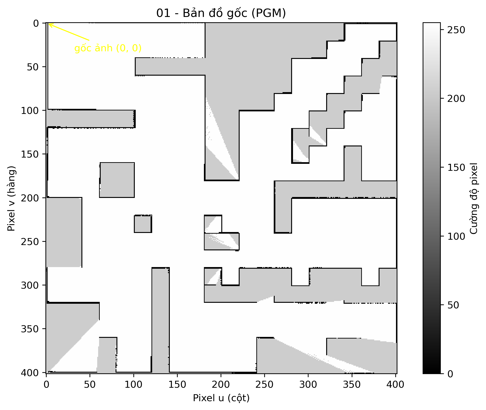
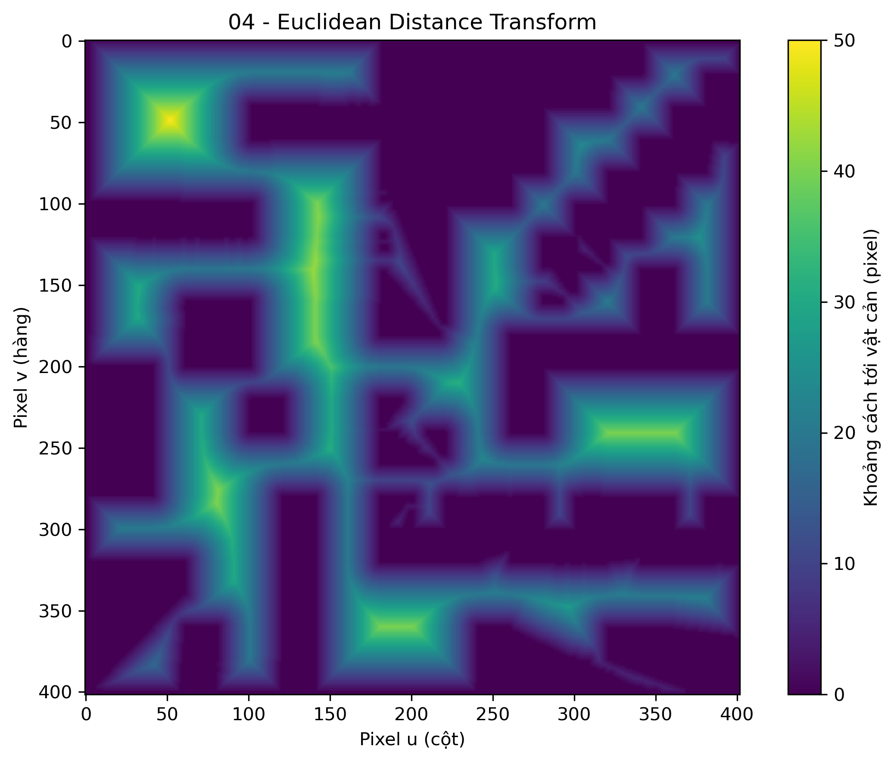
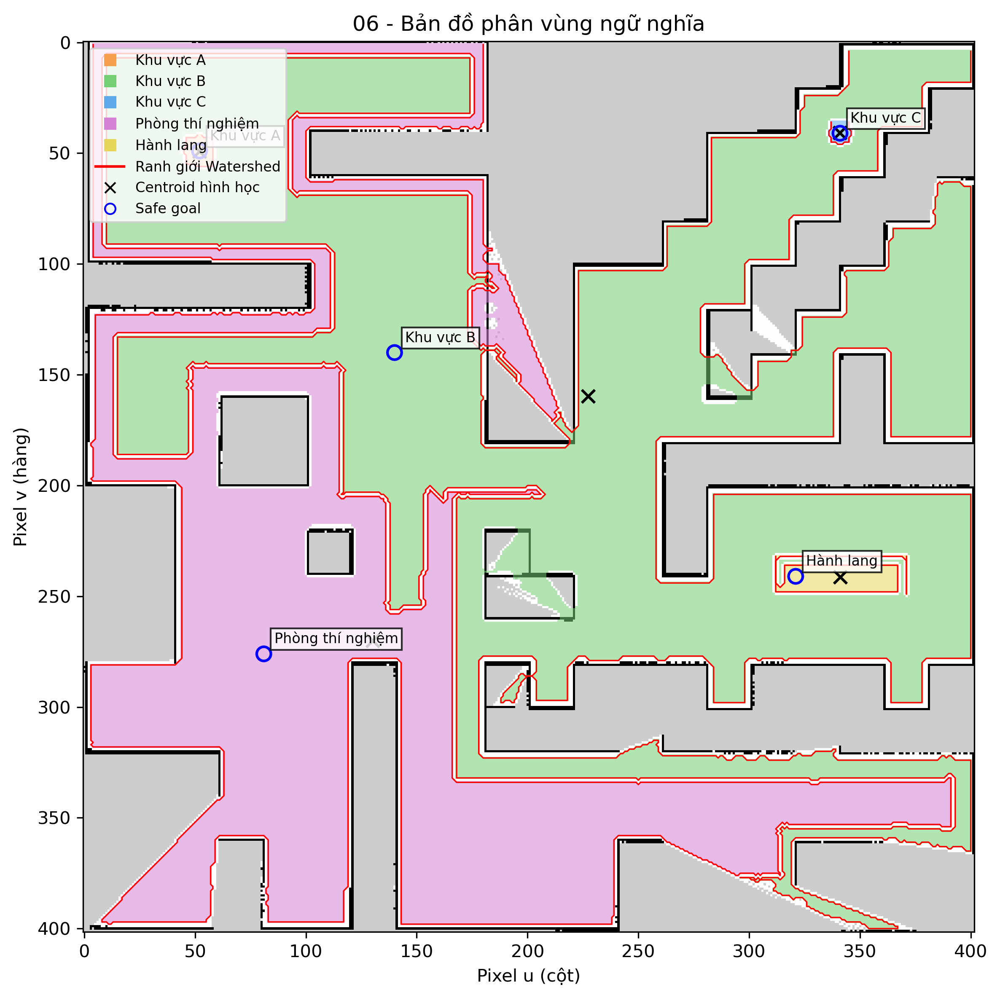

# BÁO CÁO BÀI 7
## Phân vùng bản đồ và điều hướng TurtleBot 4 bằng giọng nói

**Nền tảng:** ROS 2 Humble, Ubuntu 22.04, OpenCV, Nav2
**Package:** `tb4_voice_nav`

## 1. Giới thiệu và kiến trúc hệ thống

Đề tài xây dựng giao diện điều khiển TurtleBot 4 bằng câu lệnh tiếng Việt. Bản
đồ được phân vùng thành các đích ngữ nghĩa; node nhận dạng và phân tích câu
lệnh, sau đó gửi các đích hợp lệ lần lượt tới Nav2.

```mermaid
flowchart LR
    M[Microphone hoặc nhập văn bản] --> V[Node voice_commander]
    V -->|Nhận dạng tiếng Việt, tách route, kiểm tra vùng| T[/voice_nav/route_command]
    T --> N[Node semantic_navigator]
    N -->|NavigateToPose tuần tự| A[Nav2]
    A --> R[TurtleBot 4]
    N -->|MarkerArray và đường đi dự kiến| RV[RViz2]
    C[(semantic_regions.yaml)] --> V
    C --> N
```

`voice_commander` dùng Google Speech Recognition với ngôn ngữ `vi-VN` theo mặc
định; có thể cấu hình Vosk hoặc Whisper offline. `semantic_navigator` hiển thị
tên/đích trên RViz2 và gửi từng goal tới Nav2. Các node dùng cùng cấu hình
`config/semantic_regions.yaml`.

## 2. Phân vùng bản đồ và gắn nhãn ngữ nghĩa

Script `map_segmenter` đọc ảnh PGM cùng độ phân giải và gốc bản đồ từ YAML. Ảnh
được lọc pixel free-space (cường độ từ 250 trở lên), làm sạch bằng
morphological opening/closing, tính Euclidean Distance Transform để ước lượng
khoảng cách tới vật cản, rồi dùng seed markers và Watershed để tạo các vùng.
Safe goal được chọn trong free-space có khoảng cách tới vật cản lớn; centroid
hình học được tính riêng để đối chiếu.

Với ảnh cao `H`, pixel `(u, v)`, độ phân giải `r` và gốc
`(origin_x, origin_y)`, phép đổi tọa độ dùng trong bản đồ này là:

```text
x = origin_x + u * r
y = origin_y + (H - 1 - v) * r
```

`u` tăng sang phải; `v` tăng xuống dưới nên trục `y` được lật khi đổi sang
ROS `map`. Công thức trên giả định yaw của gốc bản đồ bằng 0, như map hiện tại.

### Ảnh xử lý bản đồ

**Bản đồ gốc**



**Euclidean Distance Transform**



**Kết quả phân vùng và vị trí đích**



### Thống kê các vùng

Dữ liệu dưới đây được tổng hợp từ
[`data/region_statistics.csv`](data/region_statistics.csv). Diện tích thực bằng
số pixel nhân với `resolution²`; khoảng cách an toàn được lấy tại safe goal từ
Distance Transform.

| Region ID | Tên khu vực | Diện tích (pixel) | Diện tích thực (m²) | Tâm Pixel (u, v) | Đích ROS (x, y, yaw) (m) | Khoảng cách an toàn (m) |
|---:|---|---:|---:|---|---|---:|
| 1 | Khu vực A | 183 | 0.458 | (51.99, 49.19) | (-7.400, 7.600, 0.000) | 2.500 |
| 2 | Khu vực B | 59426 | 148.565 | (227.38, 159.66) | (-3.000, 3.050, 0.000) | 2.117 |
| 3 | Khu vực C | 99 | 0.248 | (341.00, 40.70) | (7.050, 8.000, 0.000) | 1.000 |
| 4 | Phòng thí nghiệm | 37875 | 94.688 | (130.19, 270.02) | (-5.950, -3.750, 0.000) | 2.000 |
| 5 | Hành lang | 782 | 1.955 | (341.15, 241.22) | (6.050, -2.000, 0.000) | 2.000 |

## 3. Nhận dạng giọng nói và điều hướng tuần tự Nav2

Sau khi nhấn nút ghi âm, node thu âm 5 giây và chuyển tiếng nói tiếng Việt
thành văn bản. Parser chuẩn hóa dấu tiếng Việt, đối chiếu các alias trong YAML
và giữ thứ tự điểm đến xuất hiện trong câu.

- **Một điểm:** “Đi đến khu vực A” tạo route `[khu_vuc_a]`.
- **Hai điểm:** “Từ khu vực A đến khu vực B” tạo route
  `[khu_vuc_a, khu_vuc_b]`. Navigator gửi goal A trước; sau khi A thành công
  mới gửi B. Nếu robot đã cách A không quá 0.4 m thì A được xem là đã tới.
- **Nhiều điểm:** “Từ khu vực A qua hành lang C đến khu vực B” tạo route theo
  thứ tự `[khu_vuc_a, hanh_lang_c, khu_vuc_b]`.
- **Vùng không tồn tại:** nếu câu lệnh nhắc vùng không có trong cấu hình, node
  báo lỗi và hủy lệnh; route không được publish tới Nav2.

Navigator theo dõi kết quả từng goal, ghi khoảng cách còn lại trong lúc chạy,
và xử lý trạng thái thành công, hủy hoặc thất bại.

## 4. Kết quả thực nghiệm

Mỗi lần thử, kết quả được nối thêm vào
[`data/test_results.md`](data/test_results.md). File ghi số thứ tự thử nghiệm,
câu lệnh, văn bản nhận diện, route, tọa độ đích, thời gian và kết quả. Lệnh
hợp lệ được ghi sau khi navigator kết thúc route; lệnh có vùng không tồn tại
được ghi ngay khi bị chặn. Các hàng hiện tại được tạo bằng mô phỏng parser,
không phải lần chạy Nav2/Gazebo. Thời gian trong hàng mô phỏng là ước lượng:
quãng đường thẳng giữa các đích chia cho tốc độ danh định 0.2 m/s, cộng 5 giây
xử lý cho mỗi đích; trường hợp đi một đích giả định robot bắt đầu cách A 5 m.
Thời gian thực sẽ khác do đường đi tránh vật cản, vận tốc thực và trạng thái
robot.

### Bảng kết quả thử nghiệm

Các dòng bên dưới được ghi nối tiếp tự động; xem
[`data/test_results.md`](data/test_results.md) để lấy bảng đầy đủ sau các lần chạy.

| STT | Câu lệnh | Văn bản nhận diện (STT) | Chuỗi khu vực trích xuất | Tọa độ đích (x, y) | Thời gian di chuyển (s) | Kết quả (Thành công / Báo lỗi vùng không tồn tại) |
|---:|---|---|---|---|---:|---|
| 1 |  Đi đến khu vực A |  Đi đến khu vực A | khu_vuc_a | khu_vuc_a: (-7.40, 7.60) | 30 s (5 m đến A, 0.2 m/s, cộng 5 s xử lý) | Thành công  |
| 2 |  Từ khu vực A đến khu vực B |  Từ khu vực A đến khu vực B | khu_vuc_a -> khu_vuc_b | khu_vuc_a: (-7.40, 7.60); khu_vuc_b: (-3.00, 3.05) | 42 s (đường thẳng 6.33 m, 0.2 m/s, cộng 10 s xử lý) | Thành công  |
| 3 | Từ khu vực A qua hành lang C đến khu vực B |  Từ khu vực A qua hành lang C đến khu vực B | khu_vuc_a -> hanh_lang_c -> khu_vuc_b | khu_vuc_a: (-7.40, 7.60); hanh_lang_c: (6.05, -2.00); khu_vuc_b: (-3.00, 3.05) |  149 s (đường thẳng tổng 26.89 m, 0.2 m/s, cộng 15 s xử lý) | Thành công  |
| 4 | Đi đến khu vực Z |  Đi đến khu vực Z | khu vuc z | — | Không áp dụng (route bị chặn) | Báo lỗi vùng không tồn tại|


### Ảnh minh chứng chạy thực tế


## 5. Kết luận

Hệ thống đáp ứng các phần chính của bài toán: phân vùng free-space và tạo
semantic goals từ bản đồ; chuyển đổi tọa độ pixel sang hệ `map`; nhận dạng và
tách route tiếng Việt theo thứ tự; chặn vùng không hợp lệ trước khi publish;
điều hướng tuần tự bằng Nav2 và hiển thị thông tin trên RViz2. Bảng CSV, bảng
Markdown kết quả thử nghiệm và các hình 300 DPI hỗ trợ lưu trữ dữ liệu và hoàn
thiện báo cáo PDF.
